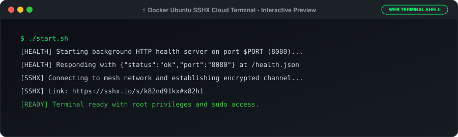
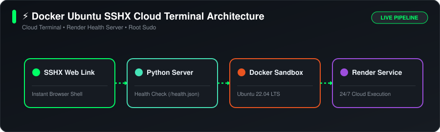

<h1 align="center">⚡ Docker Ubuntu SSHX Cloud Terminal</h1>

  

    

---

## 📸 Project Preview

  

---

# 🚀 Overview

Deploy a persistent or disposable **Ubuntu 22.04 LTS** cloud terminal accessible from anywhere via a secure, zero-config [sshx.io](https://sshx.io) link, complete with a built-in health check server for Render hosting.

---

# 🏗️ System Architecture & Data Flow

  

 

The container boots an internal lightweight HTTP daemon on `$PORT` to satisfy cloud health probes while initiating the SSHX client daemon to emit an encrypted web terminal URL.

---

# ✨ Features

✅ **Instant Web Link**: Generates an interactive web shell link on boot.\n✅ **Render Health Endpoint**: Built-in HTTP health check at `/health.json` on port `$PORT`.\n✅ **Root Access**: Preconfigured passwordless `sudo` privileges with essential developer tooling (`curl`, `git`, `python3`, `neofetch`).

---

# 📦 Installation & Quickstart

### Render Deployment\n1. Create a **New Web Service** connected to this repo on Render.\n2. Choose **Docker**.\n3. Open deployment logs to access your instant `sshx.io/s/...` link!

---

# 👤 Author & Support
- Built with ❤️ by [@itzxsahil](https://github.com/itzxsahil)
- Star ⭐ this repository if you find it helpful!
